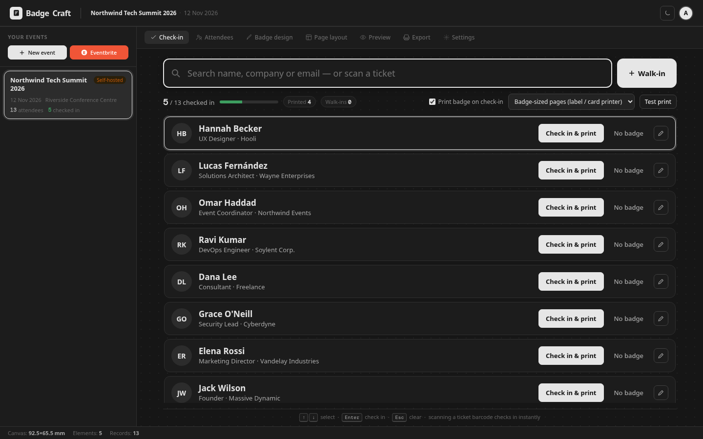
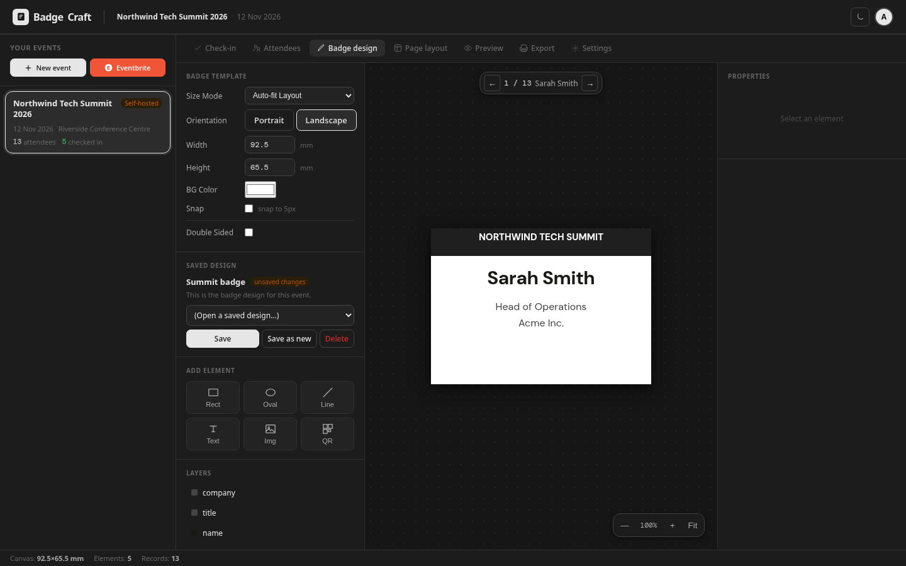
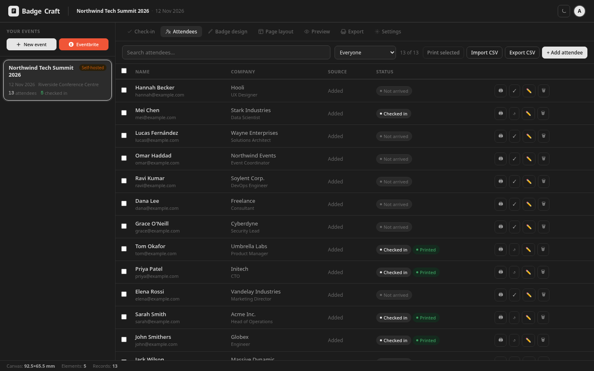
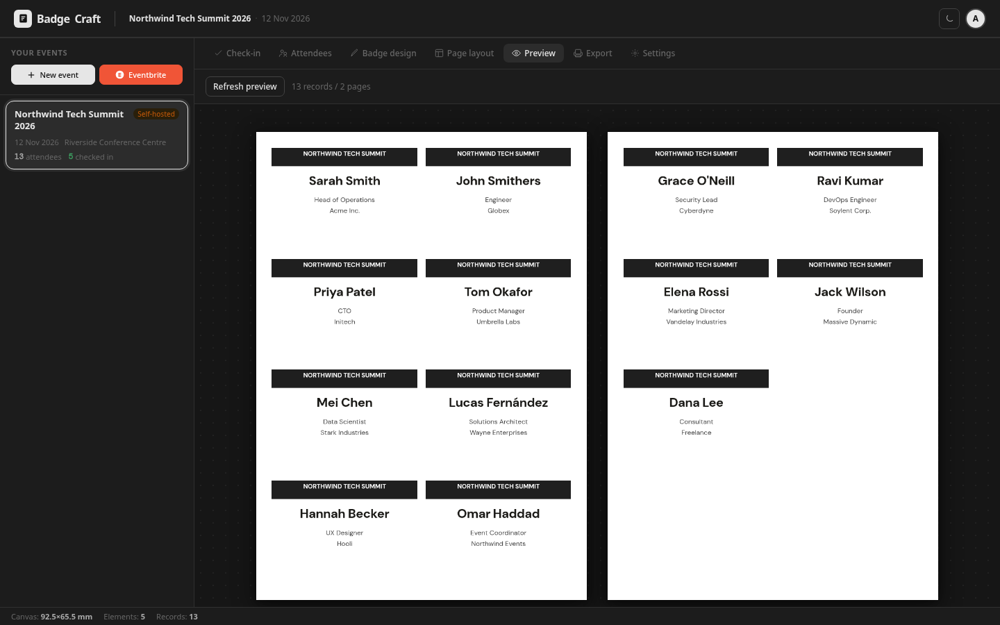
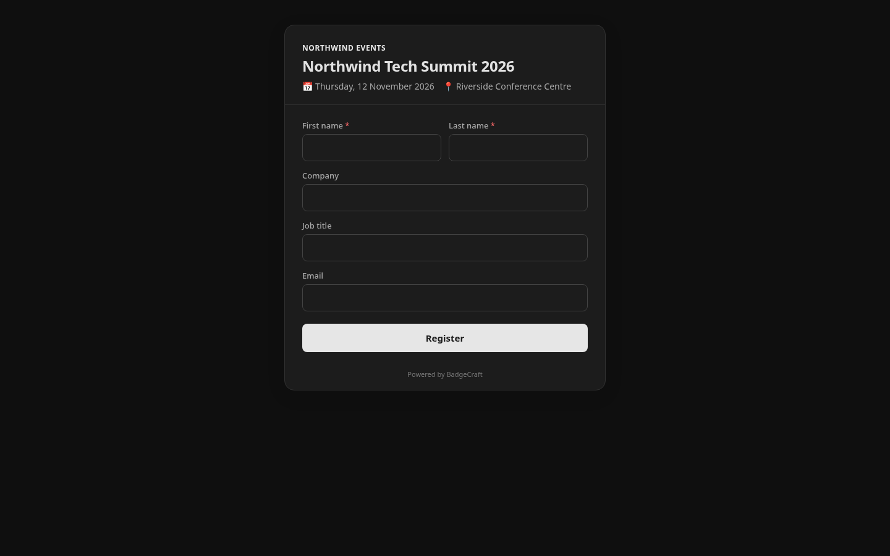

#  BadgeCraft

**Design event badges and run the reception desk: check people in and print their badge in one go.**

Run your own event or bring attendees in from Eventbrite. Several desks can work the same event at once, and everything is self-hosted.

<picture>
  <source media="(prefers-color-scheme: light)" srcset="docs/screenshots/check-in-light.png">
  
</picture>

## Features

- **Fast check-in**: search or scan a ticket, press Enter, and the badge prints. Every desk updates live
- **Walk-ins in seconds**: register, check in and print for anyone not on the list
- **Your own events or Eventbrite**: import a CSV, add people by hand, open online registration, or sync from Eventbrite
- **Self-service kiosk**: a tablet at reception where guests sign themselves in
- **Badge designer**: names, shapes, images and vCard QR codes, single or double-sided
- **A badge per attendee type**, like Staff, Speaker or Exhibitor
- **Prints to label printers or A4 sheets**, or export PDFs to print in advance
- **Teams** with owner, admin and member roles, plus CSV reports

| | |
| --- | --- |
|  |  |
|  |  |

All names and companies in the screenshots are made up.

## Install

You need Docker with Compose.

```sh
cp .env.example .env   # then set SECRET_KEY and BASE_URL
docker compose up -d --build
```

Open it on port 80 and create your account. The [user guide](docs/guide.md) covers the kiosk, Eventbrite and printer setup.

## Licence

Free and open source under the [GNU AGPL v3 or later](LICENSE). The DM Sans and DM Mono fonts are under the [SIL Open Font License](nginx/html/css/fonts/OFL-dm-sans.txt). Want to work on it? See [BUILDING.md](BUILDING.md).
