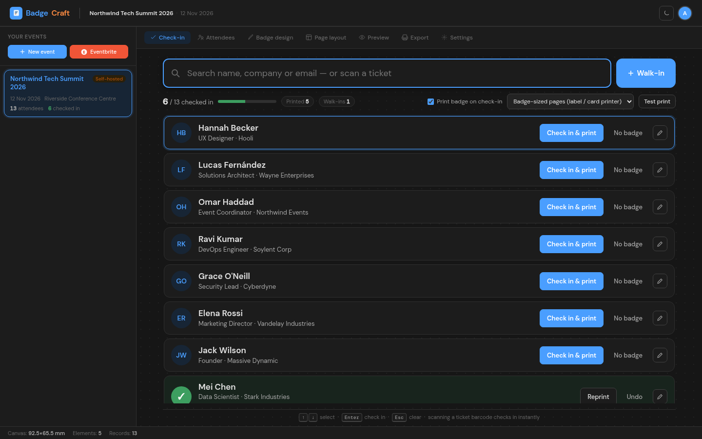
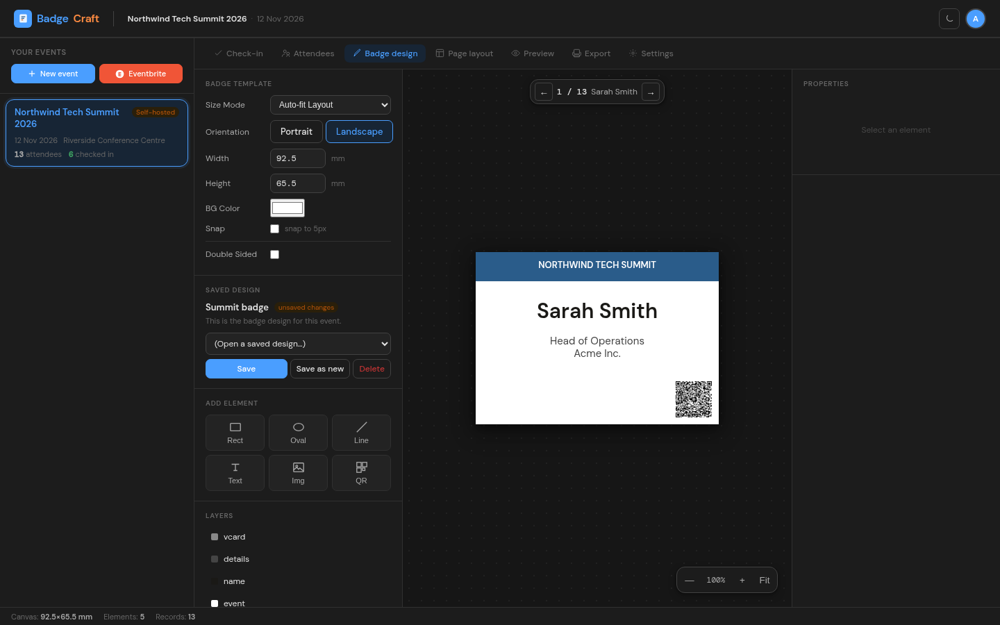
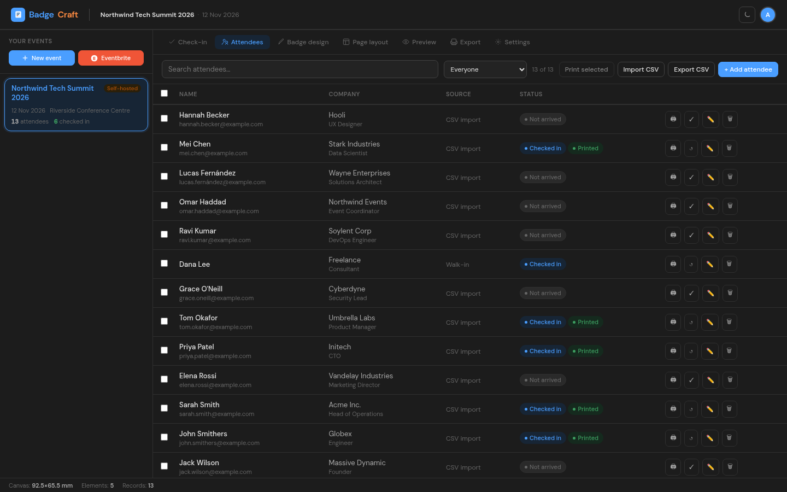
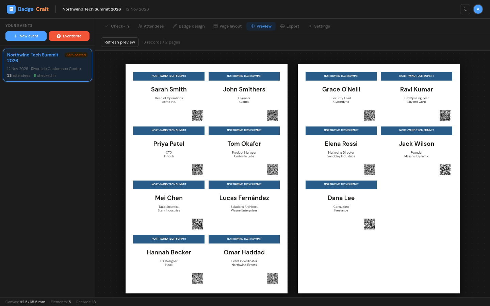
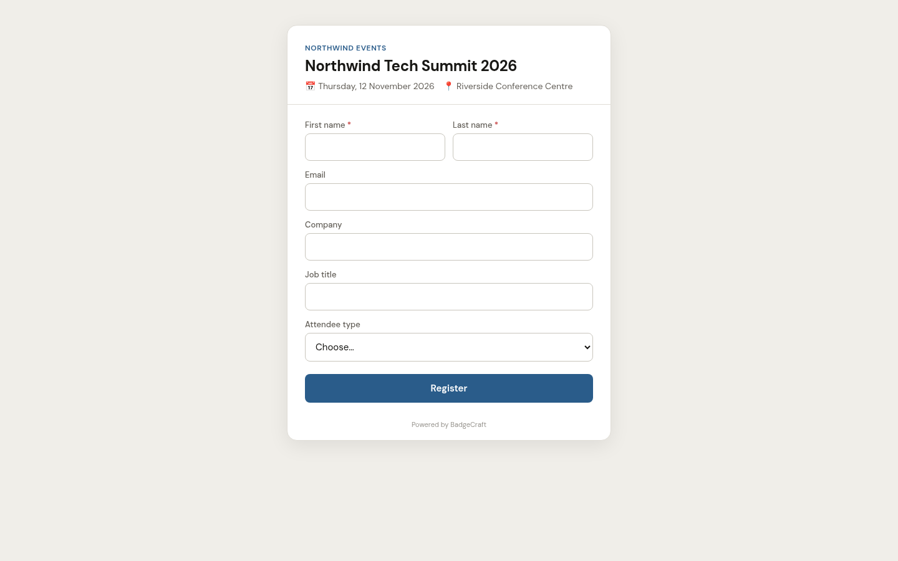

#  BadgeCraft

Event badge designer and reception check-in system. Run an event on its own or bring attendees in from Eventbrite, then check people in and print their welcome badges at the front desk. Several desks can work on the same event at once.

<picture>
  <source media="(prefers-color-scheme: light)" srcset="docs/screenshots/check-in-light.png">
  
</picture>

## Screenshots

| | |
| --- | --- |
|  |  |
| **Badge designer**: placeholders, shapes, images and vCard QR codes, previewed with real attendee data | **Attendees**: everyone on the list with source, check-in and print status |
|  |  |
| **Preview**: badges laid out on the page, ready to print or export | **Online registration**: the shareable sign-up page, also used as a reception kiosk |

All names and companies in the screenshots are made up.

## Features

- **Reception check-in desk**: search by name, company or email, or scan a ticket barcode. Enter checks the guest in and prints their badge. Every desk updates live.
- **Walk-ins**: anyone not on the list can be registered, checked in and given a badge in a few seconds. If a search finds nobody, the typed name pre-fills the walk-in form.
- **Self-hosted events**: create an event, import a CSV, add people by hand, or open **online registration**. Each event gets a shareable link and QR code.
- **Self-service kiosk**: open the registration link with `?kiosk=1` on a tablet at reception. Sign-ups are checked in automatically, and the desk gets a "Print badge" prompt.
- **Eventbrite**: import events and sync attendees on the server using the organisation's private token. Check-ins and walk-ins survive a re-sync, and cancelled or refunded tickets are flagged at the desk.
- **Badge designer**: text with `{{field}}` placeholders, shapes, images and vCard QR codes, single or double-sided. "Fit" text shrinks long names onto one line.
- **Different badges per attendee type**: map a field (ticket type, or a custom "Attendee type" choice) to a design, e.g. Staff, Speaker or Exhibitor.
- **Printing**: badges render at 300 DPI in the browser and print as badge-sized pages (label/card printers) or onto the page layout (A4 badge sheets). Bulk PDF/ZIP export is still there for pre-printing.
- **Teams**: organisations with owner, admin and member roles. Members can run the desk and add walk-ins. Admins manage events, imports and settings.
- **Reporting**: export attendees as CSV with check-in time, who checked them in, and print count.

## Running

```bash
cp .env.example .env   # then set SECRET_KEY and BASE_URL
docker compose up -d --build
```

The app is served on port 80: nginx serves `nginx/html` and proxies `/api` and `/ws` to the FastAPI backend. Data lives in SQLite in the `db_data` volume. New database columns are added automatically on startup.

| Path | What |
| --- | --- |
| `backend/main.py` | API routes: auth, organisations, events, attendees, Eventbrite, public registration, WebSocket |
| `backend/eventbrite.py` | Eventbrite API client and attendee mapping |
| `backend/models.py` | Database models and the automatic column migration |
| `nginx/html/index.html` | App markup |
| `nginx/html/js/designer.js` | Badge designer, layout, preview, PDF export, high-res badge rendering |
| `nginx/html/js/app.js` | Accounts, events, check-in desk, attendees, printing, settings |
| `nginx/html/register.html`, `js/register.js` | Public registration and kiosk page (`/r/<code>`) |

### Printing tips

- **Label or card printers** (Brother, Dymo, Zebra, Evolis…): choose *Badge-sized pages* on the Check-in tab. Set the design's badge size to match the label, and turn off headers/footers and margins in the browser print dialog.
- **A4 badge sheets / inserts**: choose *Sheet layout*. Badges are placed using the event's page layout.
- For one-click printing at a dedicated desk, Chrome can be started with `--kiosk-printing` to skip the print dialog.
- Each computer remembers its own print settings, so different desks can use different printers.

## Planned

- Badge scanning for session/room check-in
- Email confirmations for online registrations
